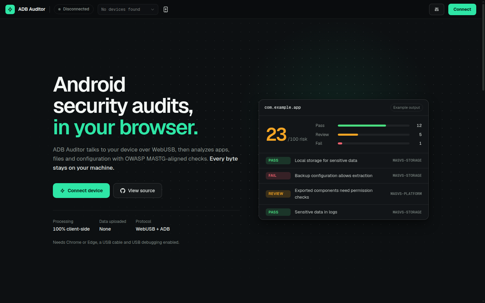
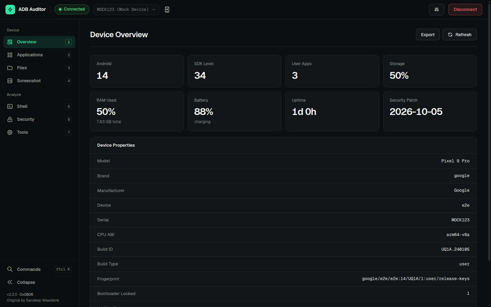
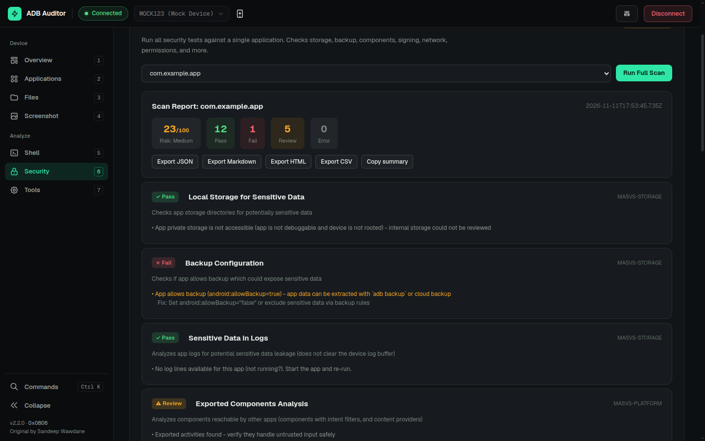
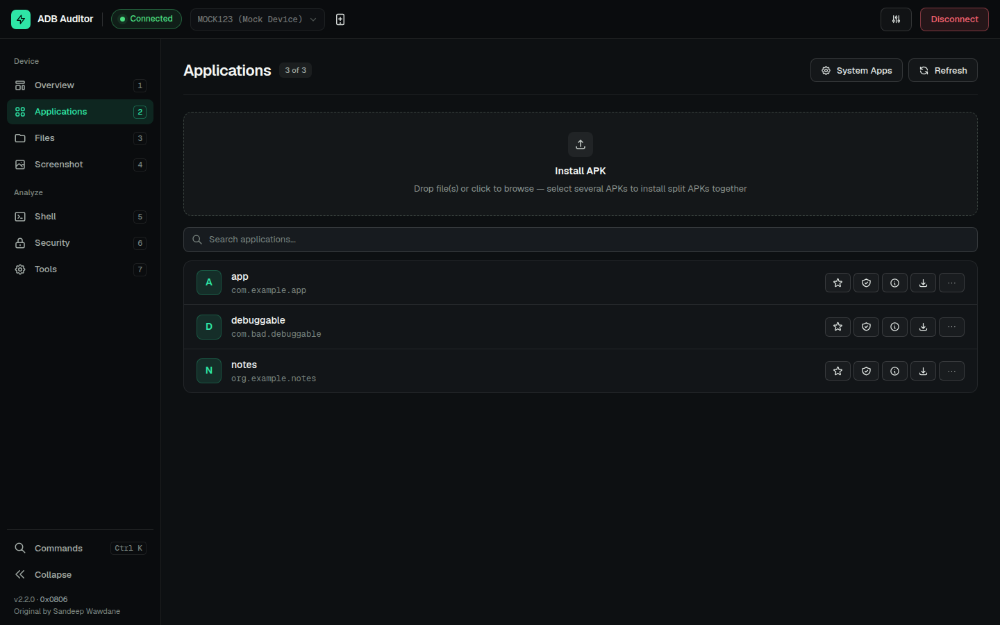
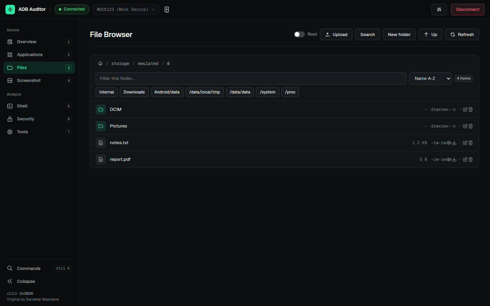
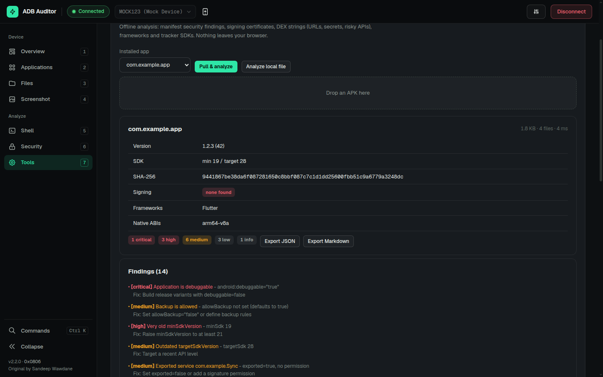
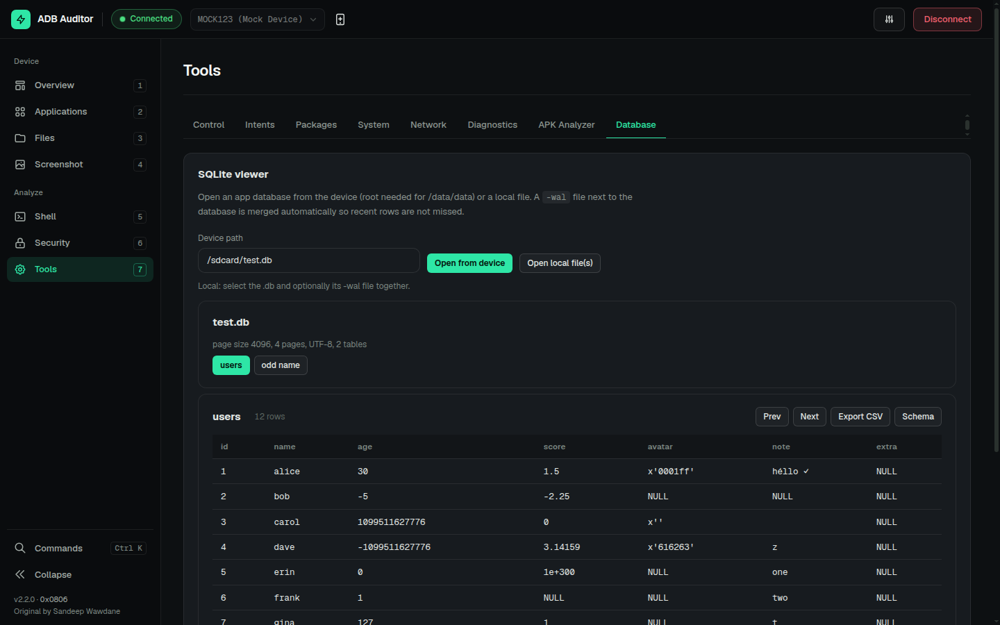
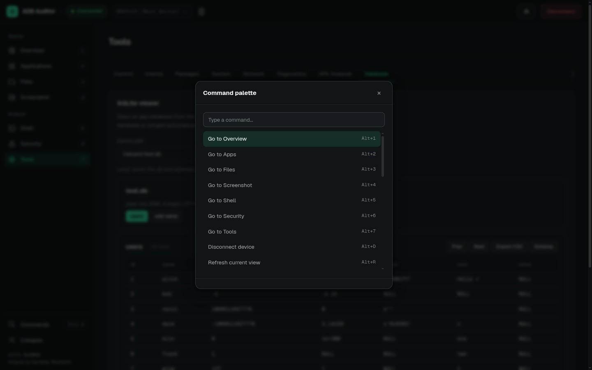

<h1 align="center">ADB Auditor</h1>

<p align="center">
  
</p>

<p align="center">
  <strong>Browser-based Android security auditing over WebUSB.</strong><br>
  No install, no server, no upload. Plug in a phone and audit it from a single tab.
</p>

<p align="center">
  Maintained and developed by <a href="https://github.com/0x0806"><strong>0x0806</strong></a><br>
  <sub>Fork of the original ADB Auditor by <a href="https://github.com/thecybersandeep/adbauditor">Sandeep Wawdane</a>. Credit for the original idea and architecture is his; see <a href="#credits">Credits</a>.</sub>
</p>

<p align="center">
  <a href="https://0x0806.github.io/adbauditor/"><strong>Open the live app</strong></a> &nbsp;·&nbsp;
  <a href="#features">Features</a> &nbsp;·&nbsp;
  <a href="#getting-started">Getting started</a> &nbsp;·&nbsp;
  <a href="#interface">Interface</a> &nbsp;·&nbsp;
  <a href="#architecture">Architecture</a> &nbsp;·&nbsp;
  <a href="#development">Development</a>
</p>

<p align="center">
  <a href="https://github.com/0x0806/adbauditor/actions/workflows/ci.yml"></a>
  
  
  
  
  
</p>

<p align="center">
  
</p>

---

## Why this exists

Mobile security reviews usually start with a pile of local tooling: platform-tools, a rooted test phone, scripts, a decompiler, a spreadsheet for notes. ADB Auditor puts the common first hour of that work into a browser tab. It speaks the ADB protocol directly over **WebUSB**, runs structured **OWASP MASTG-aligned** checks, and produces an exportable report, all on your machine. There is no backend to trust, no account, and no telemetry.

## Features

| Area | What you get |
|---|---|
| **Device overview** | Android and SDK level, patch level, storage, RAM, battery, uptime, bootloader and verified-boot state, full property list, JSON export |
| **Applications** | List, search and pin apps; pull APKs (including split APKs); install single or split APKs by drag and drop; uninstall, clear data, force-stop |
| **File browser** | Browse with optional root mode; upload, download, rename, delete, preview, checksum, in-browser editor, folder ZIP, recursive search, bookmarks, secret warning on previews |
| **Screenshots** | Capture on demand or follow the screen live; copy to clipboard or save |
| **Shell** | Real ADB shell with history, tab completion, streaming output (`Ctrl+C` to stop), root mode, transcript export |
| **Security audit** | Full scan of one app: local storage (including world-readable files), backup, log secrets, exported components, deep links, intent filters, WebView, debuggable, SDK levels, signature scheme, install source, network security config, auth storage, permissions, root and emulator indicators |
| **Device posture** | Patch age, bootloader, verified boot, SELinux, encryption, lock screen, developer options, ADB over network, Play Protect, device admins, user CAs |
| **App triage** | Rank every installed app by risk (debuggable, backup, SDK levels, dangerous permissions) and filter by permission |
| **Reports** | 0-100 risk score, per-check findings with fix advice, history and diff, export as JSON, Markdown, HTML or CSV |
| **APK analyzer** | Offline manifest, signing certificates and DEX indicators for any APK, computed in the browser |
| **SQLite viewer** | Read-only reader with WAL awareness; browse tables and export CSV |
| **Toolkit** | Intent launcher, deep-link tester, content-provider queries, permission grants, system settings, proxy, screen recording, network info, evidence pack, package baseline drift |
| **Productivity** | Command palette (`Ctrl/Cmd+K`), `Alt+1-7` navigation, activity log as an evidence trail, light and dark themes |
| **Offline** | Installable PWA; the full app works without a network after the first load |

Every device-facing action goes through validated command builders (`shQuote`, package-name and path validation), and every string that reaches the DOM is escaped. See [docs/SECURITY.md](docs/SECURITY.md).

## Getting started

### Use it online

Open **<https://0x0806.github.io/adbauditor/>** in Chrome, Edge or Opera (WebUSB is not available in Firefox or Safari).

1. On the phone, open *Settings → About phone* and tap *Build number* seven times.
2. Open *Settings → Developer options* and enable **USB debugging**.
3. Connect a **data-capable** USB cable.
4. In ADB Auditor, click **Connect** and choose the device in the browser prompt.
5. Accept the *Allow USB debugging?* dialog on the phone.

> If `adb` is running on your computer it will hold the USB interface. Run `adb kill-server` first, or the browser will report that the device is in use.

### Run it locally

The app is plain static files. There is no build step.

```bash
git clone https://github.com/0x0806/adbauditor.git
cd adbauditor
npm run serve          # python3 -m http.server 8080, then open http://localhost:8080
```

WebUSB requires a secure context, which `localhost` and `https://` both satisfy.

### Docker

```bash
docker compose up -d                        # http://localhost:8080
# or
docker build -t adbauditor . && docker run -p 8080:80 adbauditor
```

The image is `nginx:alpine` serving the static files with the security headers in [nginx.conf](nginx.conf).

### Requirements

| | |
|---|---|
| Browser | Chrome 89+, Edge 89+ or Opera 75+ (WebUSB) |
| Device | Android with USB debugging enabled; root is optional and unlocks protected paths |
| Cable | A data cable, not charge-only |

## Interface

Version 2.2 is a ground-up redesign of the interface, built to feel like an operations console rather than a marketing page. No ADB, parser or audit logic was touched.

<p align="center">
  
</p>

**Design principles**

- **One accent, real semantics.** A single signal-green accent marks actions and the current selection. Pass, review, fail and info states use their own success, warning, danger and info colours, so colour always carries meaning.
- **A real shell.** Full-width top bar with connection state and device switcher; a labelled sidebar grouped into *Device* and *Analyze*, with shortcut hints, a command-palette button and a collapse toggle that is remembered. Tablets get an icon rail with tooltips; phones get a bottom tab bar.
- **Dense where it helps.** Tables use sticky headers and tabular numerals, lists have 36-48 px rows, and long reports scan top to bottom with severity badges.
- **Both themes are first-class.** Every hairline and fill derives from a theme-aware token, so light and dark share one component set. Dark, light and system modes are in *Settings*.
- **Quiet motion.** State changes take 150-250 ms. The only choreography is one entrance on the landing page. Everything respects `prefers-reduced-motion`.
- **Accessible by default.** Skip link, visible focus ring, labelled controls, `aria-live` toasts, `aria-current` navigation and keyboard-reachable dialogs.

<table>
  <tr>
    <td width="50%"></td>
    <td width="50%"></td>
  </tr>
  <tr>
    <td align="center"><sub>Full scan with risk score and findings</sub></td>
    <td align="center"><sub>Applications with split-APK install</sub></td>
  </tr>
  <tr>
    <td></td>
    <td></td>
  </tr>
  <tr>
    <td align="center"><sub>File browser</sub></td>
    <td align="center"><sub>Offline APK analyzer</sub></td>
  </tr>
  <tr>
    <td></td>
    <td></td>
  </tr>
  <tr>
    <td align="center"><sub>SQLite viewer</sub></td>
    <td align="center"><sub>Command palette</sub></td>
  </tr>
</table>

<sub>Screenshots are captured from the hosted app against a built-in fake phone, so only demo data is shown. Regenerate them with <code>npm run screenshots</code>.</sub>

### Keyboard

| Shortcut | Action |
|---|---|
| `Ctrl/Cmd + K` | Command palette |
| `Alt + 1` … `Alt + 7` | Overview, Applications, Files, Screenshot, Shell, Security, Tools |
| `Alt + R` | Refresh the current view |
| `Alt + D` | Disconnect the device |
| `?` | Shortcut help |
| `Tab` / `↑` `↓` | Shell: complete / history |
| `Ctrl + C` / `Ctrl + L` | Shell: stop a streaming command / clear |

## Architecture

There is no framework, bundler or runtime dependency: ES2020 in the browser, loaded as classic scripts under a strict Content-Security-Policy (`script-src 'self'`, no `eval`, no inline script elements).

```
adbauditor/
├── index.html               App shell: top bar, sidebar, content mount, dialogs
├── css/
│   └── app.css              Design tokens, shell, landing, components, responsive rules
├── js/
│   ├── utils.js             Pure helpers: quoting, path and package validation, ls parsing,
│   │                        ZIP and CRC32, risk score, report export (JSON/MD/HTML/CSV)
│   ├── adb-core.js          ADB protocol over WebUSB: framing, RSA auth, serialised transport,
│   │                        shell and streaming shell, sync (push/pull), device manager
│   ├── security-auditor.js  MASTG-aligned checks, device posture, triage, secret scanning
│   ├── apk-analyzer.js      Offline ZIP, binary AndroidManifest, signing block and DEX parsing
│   ├── sqlite-reader.js     Read-only SQLite reader (b-tree, overflow, WAL, 64-bit rowids)
│   ├── toolkit.js           Validated device-control commands (intents, radios, settings, ...)
│   ├── app.js               Sections, templates, state, shortcuts, command palette
│   ├── tools-ui.js          Tools section, settings, theme, activity log
│   ├── ui.js                Interface-only behaviour: sidebar, spotlight, count-up
│   └── register-sw.js       Service worker registration
├── sw.js                    Network-first service worker with an offline precache
├── manifest.webmanifest     PWA manifest
├── 404.html                 Custom not-found page
├── img/                     Logo and README screenshots
├── tests/                   node:test suites, scriptable mock ADB device, Chromium e2e
├── scripts/                 check-syntax.js, site-check.js (deployed-site checks and screenshots)
├── docs/                    API.md, SECURITY.md
└── Dockerfile, docker-compose.yml, nginx.conf, .github/workflows/ci.yml
```

**How a request flows.** `app.js` renders a section template, a handler calls `SecurityAuditor` or `DeviceToolkit`, which builds a validated shell command and sends it through `ADBConnection` (a serialised USB transport with real timeouts). Output is parsed by pure functions in `utils.js` and rendered with escaped HTML. Nothing leaves the page.

**Design system.** `css/app.css` is organised as tokens → base → shell → buttons → landing → app surfaces → responsive → reduced motion. Hairlines and fills are mixed from one `--ink` token, so the light theme is a token swap, not a second stylesheet. Legacy token names (`--pulse`, `--lum-*`, `--depth-*`) are kept because the JS templates reference them.

Full API reference: [docs/API.md](docs/API.md).

## Development

Requires Node 18+ (22 in CI) and, for the browser suites, Chromium or Chrome.

```bash
npm ci
npm run lint        # syntax check of every file + ESLint (errors fail CI)
npm test            # 133 unit tests: protocol, auditor, APK, SQLite, toolkit, fuzzing, device manager
npm run test:e2e    # headless Chromium against a fake WebUSB device, end to end
npm run test:site   # checks a deployed copy (assets, CSP, offline, 404, connected session)
node scripts/site-check.js --serve        # same, against the working tree
npm run screenshots                        # regenerate img/screenshots from the live site
```

The protocol and device-control code is tested against a scriptable mock device, not physical hardware. The parsers are mutation-fuzzed with corrupted APK, DEX, binary XML and SQLite input. Set `ADBAUD_APK_DIR` to a folder of your own APKs to smoke-test the analyzer on real files.

CI runs lint, unit tests, the end-to-end run and a local site check on every push and pull request.

## Privacy and security

- **Nothing is uploaded.** All processing happens in your browser. There is no backend.
- **No tracking.** No analytics, telemetry or third-party scripts. The only external request is the font stylesheet.
- **Hardened by default.** Strict CSP, escaped output, shell-quoted arguments, validated package names and paths, private `no-referrer` policy.
- **Local evidence trail.** The activity log lives in your browser's storage and can be exported or cleared. *Settings → Privacy* can also forget the ADB authorization key.

Details, threat notes and the 2.0 hardening list are in [docs/SECURITY.md](docs/SECURITY.md).

## Troubleshooting

| Symptom | Try |
|---|---|
| Device not listed | Use a data cable and another port; run `adb kill-server` on your computer; revoke USB debugging authorizations on the phone and reconnect |
| "Device in use" | Another program (usually a running `adb` server) holds the interface |
| Connection drops | Keep the screen on during long transfers; check the cable; reconnect |
| Permission denied | Enable the **Root** toggle in Files or Shell (the device must be rooted) |
| Connect button does nothing | WebUSB needs Chrome, Edge or Opera and a secure context (`https://` or `localhost`) |

## Credits

**ADB Auditor was created by [Sandeep Wawdane](https://github.com/thecybersandeep)** ([@thecybersandeep](https://github.com/thecybersandeep)). The original idea, the browser-based WebUSB/ADB architecture and the first implementation are his work: <https://github.com/thecybersandeep/adbauditor>. Thank you, Sandeep.

**This fork is developed and maintained by [0x0806](https://github.com/0x0806).** Version 2.0 and 2.1 brought the hardened protocol core, a rewritten auditor, the APK analyzer, SQLite viewer, Tools section, test suite, offline mode and documentation. Version 2.2 is the interface redesign. Every change is itemised in [CHANGELOG.md](CHANGELOG.md) and attributed in [NOTICE.md](NOTICE.md).

The landing-page spotlight and count-up effects are small vanilla re-implementations of ideas from [React Bits](https://reactbits.dev); this project ships no React code.

## License

Licensed under **CC BY-NC-ND 4.0**, Copyright (c) 2026 Sandeep Wawdane (original author). See the original [LICENSE](https://github.com/thecybersandeep/adbauditor/blob/main/LICENSE) and [NOTICE.md](NOTICE.md). Note that the NoDerivatives term means modified versions should be distributed only with the original author's permission.

## Disclaimer

This tool is intended for authorized security testing and education. Make sure you have permission before testing any device. The authors are not responsible for misuse.

---

<p align="center">
  Built and maintained by <a href="https://github.com/0x0806">0x0806</a> &nbsp;·&nbsp; Original creator <a href="https://github.com/thecybersandeep/adbauditor">Sandeep Wawdane</a><br>
  <a href="https://github.com/0x0806/adbauditor/stargazers">Star the repo</a> if it saves you time.
</p>
